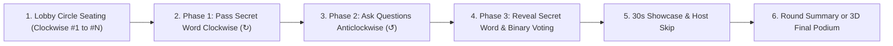

# 🗣️ THE WHISPER GAME — COMPLETE MASTER REFERENCE & ARCHITECTURE MANUAL
> **Self-Contained Knowledge Base for Developers, AI Assistants (ChatGPT/Claude), and Evaluators**  
> **Official Repository:** `https://github.com/saachikulkarni/The-Whisper-Game`  
> **Legacy Backup:** `https://github.com/saachikulkarni/Chinese-Whisper`  
> **Backend Framework:** Java 21 · Spring Boot 3.3.4 · Spring Web · Spring WebSocket · Spring Data MongoDB  
> **Frontend Stack:** Vanilla HTML5 · Modern CSS3 · ES6+ JavaScript · Web Audio API · Dynamic SVG  
> **Hosting & Cloud:** Docker · Render (`render.yaml`) · MongoDB Atlas (Optional)

---

## 📋 TABLE OF CONTENTS
1. [Project Executive Summary & Genesis](#1-project-executive-summary--genesis)
2. [Game Rules & Flow Mechanics](#2-game-rules--flow-mechanics)
   - [2.1 Seating in the Whisper Circle (Clockwise)](#21-seating-in-the-whisper-circle-clockwise)
   - [2.2 Phase 1: Clockwise Secret Word Assignment](#22-phase-1-clockwise-secret-word-assignment)
   - [2.3 Phase 2: Anticlockwise Question Flow](#23-phase-2-anticlockwise-question-flow)
   - [2.4 Phase 3: Word Reveal & Binary Majority Voting](#24-phase-3-word-reveal--binary-majority-voting)
   - [2.5 Phase 4 & 5: Round Summaries & Final Podium](#25-phase-4--5-round-summaries--final-podium)
   - [2.6 Democratic Vote-to-Kick Formula](#26-democratic-vote-to-kick-formula)
   - [2.7 30-Second Showcase Timer & Early Skip](#27-30-second-showcase-timer--early-skip)
   - [2.8 Reconnection & Session Recovery](#28-reconnection--session-recovery)
3. [System Architecture & Technology Stack](#3-system-architecture--technology-stack)
   - [3.1 Backend Architecture](#31-backend-architecture)
   - [3.2 Frontend Architecture](#32-frontend-architecture)
   - [3.3 Dual-Mode Persistence (Zero-DB In-Memory vs MongoDB Atlas)](#33-dual-mode-persistence-zero-db-in-memory-vs-mongodb-atlas)
   - [3.4 Zero-Asset Web Audio Synthesizer](#34-zero-asset-web-audio-synthesizer)
   - [3.5 Socket.IO Native WebSocket Bridge](#35-socketio-native-websocket-bridge)
4. [Exhaustive Codebase & File Tree Breakdown](#4-exhaustive-codebase--file-tree-breakdown)
5. [Complete WebSocket Protocol & Event Schema](#5-complete-websocket-protocol--event-schema)
6. [REST API Endpoints](#6-rest-api-endpoints)
7. [Data Models & DTO Reference](#7-data-models--dto-reference)
8. [Database Schema (MongoDB Atlas)](#8-database-schema-mongodb-atlas)
9. [Build, Run, Test, and Cloud Deployment Guide](#9-build-run-test-and-cloud-deployment-guide)
10. [Comprehensive FAQ & Question Answering Guide for AI](#10-comprehensive-faq--question-answering-guide-for-ai)

---

## 1. PROJECT EXECUTIVE SUMMARY & GENESIS

**The Whisper Game** (formerly titled *Chinese Whisper*) is a modern, real-time multiplayer party circle web game designed for 2 to 12+ players. It blends the hilarity of traditional circle party parlor games (like Chinese Whispers / Telephone) with a deceptive question-and-answer logic challenge.

### The Elevator Pitch
Players sit in an interactive digital circle. Each player creates a secret word and secretly gives it to their **clockwise** neighbor. Once all words are secretly distributed, the direction reverses: players ask questions **anticlockwise**. The player answering must immediately reveal their assigned secret word as the answer! The rest of the room then casts binary votes (`YES` or `NO`) on whether the revealed secret word actually makes logical sense to the question asked. Points are awarded to the question asker based on majority votes and unanimous acclaim.

---

## 2. GAME RULES & FLOW MECHANICS



### 2.1 Seating in the Whisper Circle (Clockwise)
- Players join the lobby using a 6-character room code (e.g., `KT92PX`) or direct link (`?code=KT92PX`).
- Players select an avatar from 16 emoji icons (`🦊, 🐼, 🦁, 🐯, 🦄, 🐸, 🐙, 🤖, 👽, 🦉, 🐵, 🐧, 🐲, 🐱, 🐶, 🚀`).
- Players are arranged sequentially in a clockwise circle starting at 12 o'clock:
  $$\text{Player } 1 \to \text{Player } 2 \to \text{Player } 3 \to \dots \to \text{Player } N$$
- Minimum players required to start: **2** (recommended 3–8 for maximum party fun). Maximum lobby size: **12**.

### 2.2 Phase 1: Clockwise Secret Word Assignment (↻)
- Every player secretly chooses a unique word, phrase, name, or concept for their clockwise neighbor:
  $$\text{Player } i \xrightarrow{\text{gives secret word to}} \text{Player } (i \bmod N) + 1$$
  *(Player 1 gives to 2, 2 gives to 3, ..., Player $N$ gives to Player 1).*
- Words are kept strictly secret on the server; only the recipient holds their private word.

### 2.3 Phase 2: Anticlockwise Question Flow (↺)
- The turn order reverses to prevent collusion:
  $$\text{Player } N \xrightarrow{\text{asks}} \text{Player } N-1$$
  $$\text{Player } N-1 \xrightarrow{\text{asks}} \text{Player } N-2$$
  $$\dots$$
  $$\text{Player } 1 \xrightarrow{\text{asks}} \text{Player } N$$
- The asker can type any custom question or click pre-built prompt spark categories (*Hilarious, Awkward, Survival, Wild*).
- When the question is submitted, the target's secret word is immediately revealed on screen as their answer!

### 2.4 Phase 3: Word Reveal & Binary Majority Voting
- **Hot Seat:** The Question Asker is placed in the "Hot Seat" and **cannot vote** on their own question.
- **Eligible Voters:** All remaining $N - 1$ players (including the target whose word was revealed) cast a binary vote:
  - 🟢 **YES! (Makes Sense)**: The word logically or humorously answers the question.
  - 🔴 **NO! (Nonsense)**: The word is completely unrelated nonsense.
- **Scoring Algorithm (Awarded to the Question Asker):**
  $$\text{Base Score} = \text{Count of YES votes}$$
  $$\text{Majority Bonus} = +2 \text{ if } \text{YES} > \frac{N - 1}{2}$$
  $$\text{Unanimous Bonus} = +1 \text{ if } \text{YES} = N - 1 \quad (\text{for } N > 2)$$
  $$\text{Max Possible Score per Turn} = (N - 1) + 2 + 1 = N + 2$$

### 2.5 Phase 4 & 5: Round Summaries & Final Podium
- **Round Results:** Summarizes round winners, question/answer highlights, and round-specific points.
- **Final Results:** Celebratory fanfare sound, confetti shower, and an animated 3D podium for 1st 🥇, 2nd 🥈, and 3rd 🥉 place.

### 2.6 Democratic Vote-to-Kick Formula
- Any player can initiate a kick vote against any other player in the room.
- Kick buttons are accessible both in the lobby list and directly on the circle seat avatars.
- **Strict Democratic Majority Requirement:**
  $$\text{Eligible Voters} = N - 1$$
  $$\text{Required Votes to Kick} = \left\lfloor \frac{N - 1}{2} \right\rfloor + 1$$
- If the required threshold is reached, the server removes the player, rebalances the Whisper Circle, reassigns the host if the host was kicked, and notifies all clients.

### 2.7 30-Second Showcase Timer & Early Skip
- After voting concludes, the revealed question, answer, vote tally, and verdict remain highlighted for **30 seconds** with an animated countdown progress bar.
- The **Room Host** has a prominent **"⏭️ Skip to Next Question"** button to advance immediately without waiting.

### 2.8 Reconnection & Session Recovery
- Player session tokens and room codes are stored in browser `sessionStorage`.
- If a player accidentally refreshes their page or their internet briefly drops, the client automatically sends a `reconnectPlayer` event to reclaim their seat, score, and private secret word without resetting the game.

---

## 3. SYSTEM ARCHITECTURE & TECHNOLOGY STACK

```text
┌────────────────────────────────────────────────────────────────┐
│                       BROWSER CLIENT                           │
│  index.html · style.css · app.js · circle.js · audio.js        │
│  socket.io/socket.io.js (Native WebSocket Shim)                │
└───────────────────────────────┬────────────────────────────────┘
                                │ WebSocket (ws://host/ws)
                                │ HTTP GET / (Static Web Assets)
                                ▼
┌────────────────────────────────────────────────────────────────┐
│                   SPRING BOOT 3.3.4 (JAVA 21)                  │
│                                                                │
│  [GameWebSocketHandler] ──> [GameService (State Machine)]      │
│            ▲                               │                   │
│            │                               ▼                   │
│  [WebSocketConfig]          [ScheduledExecutorService]         │
│                                            │                   │
│  [WebMvcConfig & Controller]               ▼ (Async save)      │
│                                   [MongoHistoryService]        │
└────────────────────────────────────────────┬───────────────────┘
                                             │
                      ┌──────────────────────┴──────────────────────┐
                      ▼                                             ▼
          Mode 1: IN-MEMORY ENGINE                      Mode 2: MONGODB ATLAS
        (Default, ConcurrentHashMap)                  (Optional, if MONGODB_URI set)
```

### 3.1 Backend Architecture
- **Language & Runtime:** Java 21 LTS (OpenJDK Temurin).
- **Core Framework:** Spring Boot 3.3.4.
- **Real-Time Communication:** Native Spring WebSocket API (`TextWebSocketHandler`) registered at `/ws` with allowed origins `*`.
- **Concurrency & State Management:** Game rooms are kept in thread-safe `ConcurrentHashMap<String, Game>`. Real-time timers (30-second showcases, delays) are governed by a multi-threaded `ScheduledExecutorService`.

### 3.2 Frontend Architecture
- **No Heavy Build Tools Needed:** Zero Webpack, Vite, or npm bundle steps required. Vanilla HTML5, modern CSS3, and ES6 JavaScript run straight out of the browser or Spring Boot's `resources/static/` directory.
- **Responsive Whisper Circle:** Dynamically calculated coordinates using trigonometric projection ($x = r \cdot \cos\theta, y = r \cdot \sin\theta$) to position players in an SVG/CSS circle with responsive radius adjustments for mobile screens.

### 3.3 Dual-Mode Persistence (Zero-DB In-Memory vs MongoDB Atlas)
The project features an automatic zero-config dual-mode storage engine:
1. **Mode 1: High-Performance In-Memory (Default):**
   - If `MONGODB_URI` is empty, Spring Boot excludes MongoDB auto-configurations (`MongoAutoConfiguration.class`, `MongoDataAutoConfiguration.class`).
   - The game runs 100% in server RAM using `ConcurrentHashMap`. Zero external database required.
2. **Mode 2: MongoDB Atlas Cloud Persistence:**
   - When `MONGODB_URI` is provided in environment variables, `MongoConfig` instantiates a `MongoTemplate` connected to the `whisper_game` database.
   - Finished games, player rankings, QA histories, and timestamps are automatically archived asynchronously into the `game_history` collection.

### 3.4 Zero-Asset Web Audio Synthesizer (`audio.js`)
Rather than loading bulky `.mp3` or `.wav` sound files over slow cellular networks, the game features a built-in polyphonic synthesizer using the browser's native **Web Audio API**:
- `gameStart`: 4-note ascending fanfare (C4 $\to$ E4 $\to$ G4 $\to$ C5).
- `yourTurn`: Ascending chime (C5 $\to$ E5 $\to$ G5).
- `wordPass`: Frequency-ramping whoosh sound.
- `wordReveal`: Square-wave suspense drumroll followed by a major triad chord.
- `celebrate`: 5-note victory fanfare.
- `votePop` & `reactionPop`: Dynamic frequency pop tones.

### 3.5 Socket.IO Native WebSocket Bridge (`socket.io.js`)
To allow the frontend to use clean, intuitive event-driven syntax (`socket.on(event, fn)`, `socket.emit(event, data)`), a native 90-line client adapter (`socket.io/socket.io.js`) shims standard browser WebSockets:
```javascript
// Automatically detects ws:// vs wss:// and adapts to Spring Boot's /ws endpoint
window.io = function(url) {
    return new SimpleSocket(url);
};
```

---

## 4. EXHAUSTIVE CODEBASE & FILE TREE BREAKDOWN

```text
The-Whisper-Game/
├── .gitignore                                           # Comprehensive Git ignore rules
├── Dockerfile                                           # Multi-stage Docker build for Java 21
├── render.yaml                                          # One-click Render cloud deployment Blueprint
├── README.md                                            # Master documentation
├── THE_WHISPER_GAME_MASTER_REFERENCE.md                 # Complete system reference manual (this file)
│
├── backend-springboot/                                  # ☕ SPRING BOOT BACKEND
│   ├── pom.xml                                          # Maven project descriptor (Spring Boot 3.3.4, Java 21)
│   ├── mvnw / mvnw.cmd                                  # Self-contained Maven wrapper binaries
│   ├── .mvn/wrapper/                                    # Maven wrapper properties & jar
│   ├── Dockerfile                                       # Backend-specific Dockerfile
│   ├── README.md                                        # Backend developer guide
│   ├── src/
│   │   ├── main/
│   │   │   ├── java/com/whispergame/
│   │   │   │   ├── TheWhisperGameApplication.java       # Main entry point (excludes Mongo AutoConfig if empty)
│   │   │   │   ├── config/
│   │   │   │   │   ├── WebSocketConfig.java             # Registers /ws handler and sets CORS to *
│   │   │   │   │   ├── WebMvcConfig.java                # Maps static client web resources
│   │   │   │   │   └── MongoConfig.java                 # Conditional MongoTemplate initialization
│   │   │   │   ├── controller/
│   │   │   │   │   └── GameController.java              # REST endpoints (/health, /api/game/{code})
│   │   │   │   ├── handler/
│   │   │   │   │   └── GameWebSocketHandler.java        # WebSocket lifecycle, routing, and broadcasts
│   │   │   │   ├── service/
│   │   │   │   │   ├── GameService.java                 # Core state machine, scoring, kick, turns, timers
│   │   │   │   │   └── MongoHistoryService.java         # Asynchronous MongoDB game archiving
│   │   │   │   ├── model/
│   │   │   │   │   ├── Phase.java                       # Enum: LOBBY, WORD_PASS, QUESTIONS, VOTING, etc.
│   │   │   │   │   ├── Player.java                      # Player entity (id, session, name, avatar, score)
│   │   │   │   │   ├── Game.java                        # Game room state, player list, timers, kick votes
│   │   │   │   │   ├── Round.java                       # Round state, given words, questions, vote counts
│   │   │   │   │   ├── QuestionPair.java                # Asker index -> Target index mapping
│   │   │   │   │   ├── QARecord.java                    # QA historical record (question, answer, votes)
│   │   │   │   │   └── entity/GameHistoryDocument.java  # MongoDB document mapping for games
│   │   │   │   └── dto/
│   │   │   │       ├── WsMessage.java                   # Inbound WebSocket packet wrapper (event + data)
│   │   │   │       ├── PublicGameState.java             # Sanitized state sent to clients
│   │   │   │       └── AnswerResultDto.java             # 30-second showcase payload
│   │   │   └── resources/
│   │   │       ├── application.properties               # Configures server.port=${PORT:8080}
│   │   │       └── static/                              # Bundled production web client
│   │   └── test/java/com/whispergame/
│   │       └── TheWhisperGameApplicationTests.java      # Automated Spring Boot integration tests
│   └── target/
│       └── the-whisper-game-1.0.0.jar                   # Compiled executable JAR
│
└── client/                                              # 🌐 WEBPAGE CLIENT SOURCE
    ├── index.html                                       # Game UI, stages, modal dialogues, overlays
    ├── css/
    │   └── style.css                                    # Glowing dark theme, neon colors, animations
    ├── js/
    │   ├── app.js                                       # Client state manager, event listeners, UI switcher
    │   ├── circle.js                                    # WhisperCircle dynamic trigonometry renderer
    │   └── audio.js                                     # Synthesized Web Audio API sound generator
    └── socket.io/
        └── socket.io.js                                 # Spring Boot native WebSocket client shim
```

---

## 5. COMPLETE WEBSOCKET PROTOCOL & EVENT SCHEMA

All WebSocket communication occurs over `ws://<host>/ws` (or `wss://<host>/ws` in production SSL) using JSON packets:

```json
{
  "event": "EVENT_NAME",
  "data": { ... }
}
```

### 5.1 Client-to-Server Events

| Event Name | Data Payload Example | Description |
|:---|:---|:---|
| `createGame` | `{"username": "Alice", "avatar": "🦊", "rounds": 3}` | Host creates a new room with custom rounds (1–10). |
| `joinGame` | `{"code": "KT92PX", "username": "Bob", "avatar": "🦁"}` | Player joins an existing game room. |
| `reconnectPlayer` | `{"code": "KT92PX", "playerId": "p_8a3f910b"}` | Player reclaims disconnected session on page refresh. |
| `startGame` | `{}` | Room Host starts the game from the lobby. |
| `submitWord` | `{"word": "Elephant"}` or `"Elephant"` | Player submits their secret word for clockwise neighbor. |
| `submitQuestion` | `{"question": "What is in your fridge?"}` | Current Asker submits question for anticlockwise target. |
| `vote` | `{"vote": "yes"}` or `{"vote": "no"}` | Eligible voter submits binary vote on revealed answer. |
| `voteKickPlayer` | `{"targetPlayerId": "p_9c1e2f4a"}` | Player casts or toggles a democratic kick vote. |
| `kickPlayer` | `{"targetPlayerId": "p_9c1e2f4a"}` | Room Host immediately kicks player. |
| `skipTurn` | `{}` | Room Host skips an inactive player during Question phase. |
| `skipResultDisplay`| `{}` | Room Host skips the 30-second reveal showcase timer. |
| `nextRound` | `{}` | Room Host advances to the next round from Round Summary. |
| `restartGame` | `{}` | Room Host resets the game back to the lobby after finish. |
| `sendReaction` | `{"emoji": "🔥"}` | Broadcasts floating emoji reaction to all players. |

### 5.2 Server-to-Client Events

| Event Name | Data Payload Contents | Description |
|:---|:---|:---|
| `state` | `PublicGameState` object | Complete sanitized game state broadcast to player. |
| `gameCreated` | `{"code": "KT92PX", "playerId": "p_123"}` | Acknowledges room creation to host. |
| `joinedGame` | `{"code": "KT92PX", "playerId": "p_456"}` | Acknowledges player join. |
| `reconnectedSuccess` | `{"code": "KT92PX"}` | Confirms session reconnection. |
| `privateSecretWord` | `{"secretWord": "...", "giverName": "..."}` | Delivers the private assigned word only to its recipient. |
| `wordSealed` | `{"giverName": "Alice", "receiverName": "Bob"}` | Informs room that a secret word was locked in. |
| `allWordsSealed` | `{"message": "All words sealed! Ready..."}` | Alerts room that Question Phase is starting. |
| `questionRevealed` | Asker info, target info, question, revealed word | Displays question & answer on screen. |
| `voteSubmitted` | `{"vote": "yes"}` | Confirms to voter that their vote was recorded. |
| `voteProgress` | `{"votesReceived": 3, "totalVoters": 4}` | Real-time progress bar of submitted votes. |
| `answerResult` | `AnswerResultDto` (votes, points, majority flag, 30s) | Initiates the 30-second showcase timer. |
| `roundFinished` | `{"round": 1, "winners": [...]}` | Shows round podium and QA highlights. |
| `gameFinished` | `{"winners": [...]}` | Triggers final 3D podium and confetti shower. |
| `kickVoteProgress` | `{"targetName": "...", "currentVotes": 2, "requiredVotes": 3}` | Updates kick vote status pill. |
| `playerKicked` | `{"username": "Bob", "reason": "majority"}` | Notifies room of kicked player. |
| `kickedFromGame` | `{"message": "You were kicked..."}` | Sent to the player who was removed. |
| `soundEffect` | String (`gameStart`, `wordReveal`, `celebrate`, etc.) | Triggers client Web Audio synthesizer. |
| `reactionFired` | `{"emoji": "🔥", "username": "Alice"}` | Renders floating animated emoji. |
| `errorMessage` | Error string | Displays user-friendly error popup toast. |

---

## 6. REST API ENDPOINTS

In addition to WebSocket communication, Spring Boot exposes lightweight HTTP REST endpoints:

### 1. Server Health Check
- **Endpoint:** `GET /health`
- **Purpose:** Cloud health checks, uptime monitoring, and ping testing.
- **Sample Response:**
```json
{
  "status": "UP",
  "service": "The Whisper Game Backend (Spring Boot)",
  "activeGames": 2,
  "timestamp": 1729864200000,
  "mongoConnected": true
}
```

### 2. Game Info Query
- **Endpoint:** `GET /api/game/{code}`
- **Purpose:** Allows external web interfaces or bots to check if a game room exists and is joinable.
- **Sample Response:**
```json
{
  "gameCode": "KT92PX",
  "phase": "lobby",
  "currentRound": 0,
  "totalRounds": 3,
  "playerCount": 4,
  "canJoin": true
}
```

---

## 7. DATA MODELS & DTO REFERENCE

### `Game.java` (Server Game Session)
```java
public class Game {
    private final String code;                                // 6-letter uppercase room code
    private String hostPlayerId;                              // Current host player ID
    private final int rounds;                                 // Total rounds configured (1-10)
    private int currentRound;                                 // Current active round number
    private Phase phase = Phase.LOBBY;                        // Current phase
    private final List<Player> players = new CopyOnWriteArrayList<>(); // Seated players
    private Round round;                                      // Current round data
    private final Map<String, List<String>> kickVotes = new ConcurrentHashMap<>(); // targetId -> voterIds
    private ScheduledFuture<?> resultTimer;                   // Active 30s showcase timer
}
```

### `Player.java` (Participant Entity)
```java
public class Player {
    private final String id;       // Unique ID: p_xxxxxxxx
    private String sessionId;      // WebSocket session ID
    private String username;        // Screen name (max 25 chars)
    private String avatar;          // Emoji avatar
    private int score = 0;          // Total points
    private boolean connected = true;
    private String secretWord = ""; // Assigned secret word (kept private)
    private String giverName = "";  // Name of player who gave the secret word
}
```

### `Round.java` (Round State & Pairings)
```java
public class Round {
    private final List<String> givenWords;                  // Words passed by index [0..N-1]
    private int submittedCount = 0;                         // Count of submitted words
    private List<QuestionPair> questionPairs;               // Anticlockwise pairings
    private int questionIndex = 0;                          // Current question turn index
    private String currentQuestion;                         // Current question text
    private String currentTargetId;                         // Target whose word is revealed
    private String revealedWord;                            // Revealed secret word
    private final Map<String, String> votes;                // voterPlayerId -> "yes" / "no"
    private final List<QARecord> qaHistory;                 // Historical log of round turns
    private final Map<String, Integer> roundScores;         // playerId -> points won this round
    private List<String> winnerIds;                         // Round winner IDs
}
```

### `Phase.java` (State Machine Lifecycle)
```java
public enum Phase {
    LOBBY("lobby"),
    WORD_PASS("wordPass"),
    QUESTIONS("questions"),
    VOTING("voting"),
    ROUND_RESULTS("roundResults"),
    FINAL_RESULTS("finalResults");
}
```

---

## 8. DATABASE SCHEMA (MONGODB ATLAS)

When `MONGODB_URI` is provided, games are saved into the `whisper_game` database under collection `game_history`.

### `GameHistoryDocument` Structure:
```json
{
  "_id": "671cb0a81234567890abcdef",
  "gameCode": "KT92PX",
  "hostUsername": "Alice",
  "totalRounds": 3,
  "completedRounds": 3,
  "createdAt": "2026-10-26T14:20:00.000Z",
  "winners": ["Alice", "Charlie"],
  "players": [
    { "id": "p_101", "username": "Alice", "avatar": "🦊", "score": 14 },
    { "id": "p_102", "username": "Bob", "avatar": "🦁", "score": 8 },
    { "id": "p_103", "username": "Charlie", "avatar": "🐼", "score": 14 }
  ],
  "_class": "com.whispergame.model.entity.GameHistoryDocument"
}
```

---

## 9. BUILD, RUN, TEST, AND CLOUD DEPLOYMENT GUIDE

### 9.1 Local Development Prerequisites
- **Java 21 LTS** (Eclipse Adoptium Temurin OpenJDK 21)
- Terminal (PowerShell or Bash)

### 9.2 Running Locally
1. Navigate to the backend directory:
   ```powershell
   cd backend-springboot
   ```
2. Launch the Spring Boot application using the included Maven Wrapper:
   ```powershell
   .\mvnw.cmd spring-boot:run
   ```
   *(On macOS/Linux: `./mvnw spring-boot:run`)*
3. Open your browser at:
   - 🌐 **Web Game:** `http://localhost:8080`
   - 🩺 **Health Check:** `http://localhost:8080/health`

### 9.3 Running Automated Unit & Integration Tests
```powershell
cd backend-springboot
.\mvnw.cmd test
```
*Current test suite: 2/2 tests passing (Context load & REST health endpoint validation).*

### 9.4 Deploying on Render (Free Cloud Hosting)
1. Push your repository to GitHub: `https://github.com/saachikulkarni/The-Whisper-Game`.
2. Log into **[render.com](https://render.com/)** using GitHub.
3. Click **New +** $\to$ **Web Service**.
4. Select `The-Whisper-Game` and configure:
   - **Runtime:** `Docker`
   - **Root Directory:** *(leave blank)*
   - **Plan:** `Free`
   - **Environment Variable (Optional):**
     - `MONGODB_URI`: `mongodb+srv://<user>:<password>@cluster0.mongodb.net/whisper_game?retryWrites=true&w=majority`
5. Click **Deploy Web Service**. Render compiles the container and assigns a live URL:
   `https://the-whisper-game.onrender.com`

---

## 10. COMPREHENSIVE FAQ & QUESTION ANSWERING GUIDE FOR AI

When answering questions about this project in ChatGPT or any LLM, use the following authoritative answers:

### Q1: Can The Whisper Game run completely without MongoDB?
**Answer:** **Yes, 100%.** MongoDB is completely optional. If `MONGODB_URI` is omitted or empty, `MongoConfig` skips database initialization, and `GameService` runs purely in-memory using thread-safe `ConcurrentHashMap`. The entire game—lobby, word passing, questions, voting, 30s showcase, and final podium—works flawlessly with zero external database dependencies.

### Q2: Why does the project have a `socket.io.js` file if the backend is Spring Boot Java?
**Answer:** The frontend was originally designed using the Socket.IO client API syntax (`socket.on(...)`, `socket.emit(...)`). To keep the frontend lightweight without forcing complex WebSocket rewrites, a custom 90-line adapter was authored in `client/socket.io/socket.io.js`. It wraps the browser's standard `WebSocket` API and connects directly to Spring Boot's native `/ws` endpoint while exposing the exact same `io()` API.

### Q3: How does the voting and scoring system work?
**Answer:** The Question Asker is in the "Hot Seat" and cannot vote. The remaining $N - 1$ players vote binary: `YES` (makes sense) or `NO` (nonsense).
- Asker receives **1 base point** per `YES` vote.
- Asker receives **+2 bonus points** if `YES` votes exceed 50% of voters.
- Asker receives **+1 unanimous bonus** if 100% of voters voted `YES` (for games $> 2$ players).

### Q4: How is the democratic Vote-to-Kick calculated?
**Answer:** Any player can initiate a kick vote on another player. The threshold is a strict democratic majority of all other players in the room:
$$\text{Threshold} = \left\lfloor \frac{N - 1}{2} \right\rfloor + 1$$
For example:
- In a 3-player game: $(3-1)/2 + 1 = 2$ votes needed.
- In a 5-player game: $(5-1)/2 + 1 = 3$ votes needed.
- In an 8-player game: $(8-1)/2 + 1 = 4$ votes needed.

### Q5: How do the directions differ between Phase 1 and Phase 2?
**Answer:**
- **Phase 1 (Secret Word Pass):** **Clockwise (↻)**: Player $i$ gives a secret word to Player $i + 1$, and Player $N$ gives to Player 1.
- **Phase 2 (Questions):** **Anticlockwise (↺)**: Player $N$ asks Player $N-1$, Player $N-1$ asks $N-2$, ..., and Player 1 asks Player $N$.
This reversal ensures players cannot easily collude or ask softball questions to the person they just handed a word to.

### Q6: What happens if a player disconnects or refreshes?
**Answer:** The client stores their `gameCode` and unique `playerId` in browser `sessionStorage`. When the page reloads, the client automatically dispatches a `reconnectPlayer` WebSocket event. The server updates their WebSocket session ID, keeps their seat, restores their score, and secretly re-sends their private word.

### Q7: Where are the static frontend files served from?
**Answer:** Spring Boot serves the frontend statically through `WebMvcConfig.java` from `classpath:/static/` (bundled in the JAR) and `file:client/` (for local development). Navigating to `http://localhost:8080` or the live Render URL loads `index.html` immediately.

### Q8: What sound assets are used?
**Answer:** The project uses **zero external audio files** (.mp3 or .wav). All audio is generated algorithmically at runtime using the browser's native **Web Audio API** in `client/js/audio.js` via oscillator nodes and exponential gain envelopes.

---
*End of Master Reference Manual.*
